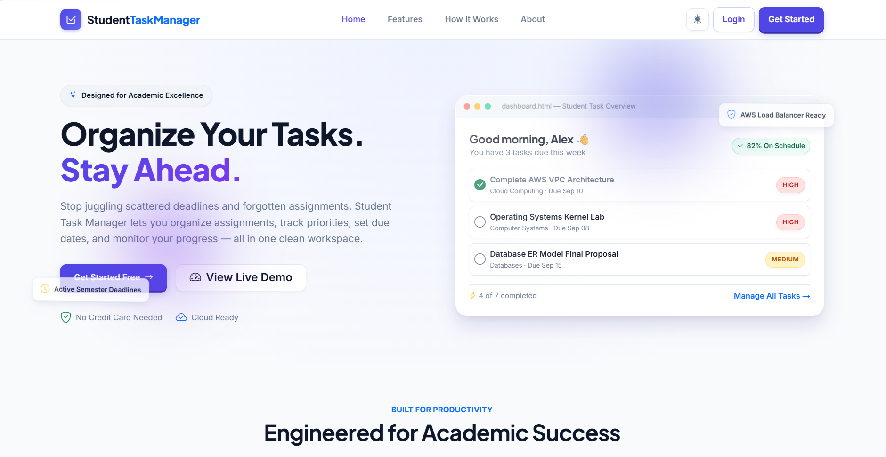
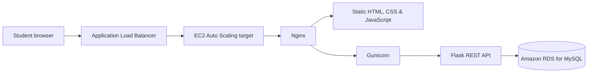

# Student Task Manager on AWS

> A polished task-management experience for students, built with a responsive browser interface and designed for a production-style AWS deployment.

[](https://aws.amazon.com/)
[](https://flask.palletsprojects.com/)
[](https://aws.amazon.com/rds/mysql/)
[](https://nodejs.org/)



## Why this project?

Student Task Manager gives students one clean place to organize coursework: create tasks, set priorities and due dates, follow progress, and manage the task lifecycle from a responsive dashboard. The frontend keeps its API communication centralized, so it can run behind a reverse proxy with the browser calling the same-origin `/api` path.

## Highlights

- Account registration and sign-in flows
- Dashboard with task totals and recent-task summary
- Create, edit, complete/reopen, and delete task flows
- Search, filter, sort, priority, status, and due-date support
- Responsive interface with themes, animations, notifications, and polished visual effects
- Centralized API client, configured for same-origin `/api` calls

## Deployment architecture



### Request flow

1. The browser requests the site through the Application Load Balancer.
2. Nginx serves the frontend files and forwards `/api` traffic to Gunicorn.
3. Gunicorn runs the Flask application.
4. Flask validates the request and reads or writes task data in Amazon RDS for MySQL.

> **Repository scope:** The browser frontend and a small Node.js server for local static preview are included here. The Flask API source, database schema, AWS infrastructure definitions, and deployment automation are managed outside this repository. The included documentation and showcase image demonstrate the deployed project context without exposing infrastructure identifiers or credentials.

## Tech stack

| Area | Technology |
| --- | --- |
| Frontend | HTML, CSS, JavaScript |
| Local preview | Node.js built-in `http`, `fs`, and `path` modules |
| API (deployment) | Flask REST API |
| App serving (deployment) | Nginx + Gunicorn |
| Cloud (deployment) | AWS ALB, EC2 Auto Scaling, and Amazon RDS for MySQL |

## Run the frontend locally

### Prerequisite

- Node.js 18 or a compatible current LTS release

### Start

```bash
npm start
```

Open [http://localhost:3000](http://localhost:3000).

The local server serves files from `frontend/`. It does **not** implement the Flask API or proxy `/api`; authenticated and data-backed actions require a compatible backend at the same origin.

## API integration

The frontend API client is centralized in [`frontend/js/api.js`](frontend/js/api.js) and uses:

```js
const API_BASE_URL = "/api";
```

This lets the deployed browser application call the backend through the same origin instead of hard-coding a server IP address.

| Method | Endpoint | Purpose |
| --- | --- | --- |
| `GET` | `/api/health` | Backend health check |
| `POST` | `/api/register` | Create an account |
| `POST` | `/api/login` | Sign in |
| `GET` | `/api/dashboard?user_id={id}` | Get dashboard summary |
| `GET` | `/api/tasks?user_id={id}` | List a user's tasks |
| `POST` | `/api/tasks` | Create a task |
| `PUT` | `/api/tasks/{id}` | Update a task |
| `DELETE` | `/api/tasks/{id}?user_id={id}` | Delete a task |
| `PATCH` | `/api/tasks/{id}/complete` | Toggle completion state |

## Repository layout

```text
.
├── assets/
│   └── showcase/               # Public, sanitized UI showcase image
├── docs/
│   ├── Report.docx             # Project report
│   └── student-task-manager-aws-guide.pdf
├── frontend/
│   ├── assets/
│   ├── css/
│   ├── js/
│   ├── index.html
│   ├── login.html
│   ├── register.html
│   ├── dashboard.html
│   ├── tasks.html
│   └── profile.html
├── package.json
└── server.js
```

## Documentation

- [AWS Student Task Manager guide (PDF)](docs/student-task-manager-aws-guide.pdf)
- [Project report (DOCX)](docs/Report.docx)
- [Documentation index](docs/README.md)

## Security notes

- Never commit AWS keys, passwords, database URLs, access tokens, or populated `.env` files.
- Keep the Flask API and database in private, controlled environments; do not expose an EC2 or database endpoint in frontend code.
- Serve public traffic through HTTPS in production.
- Do not upload screenshots containing email addresses, account IDs, private endpoints, or other personal/cloud identifiers.

## Verification checklist

- [x] Landing page and responsive UI render correctly
- [x] API base URL uses same-origin `/api`
- [x] Login and registration request paths are defined
- [x] Task creation, listing, edit, completion, and deletion request paths are defined
- [x] Dashboard and health-check request paths are defined

## License

This project is provided for portfolio and learning purposes. See [LICENSE](LICENSE).
